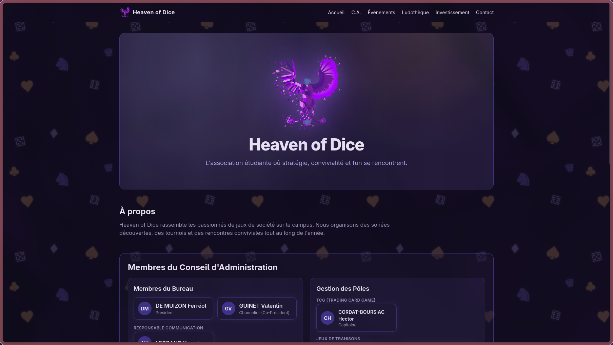
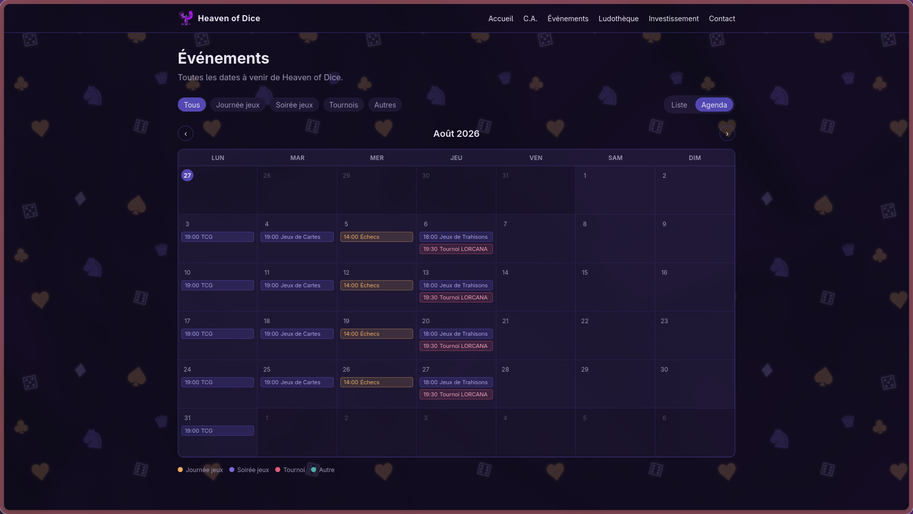
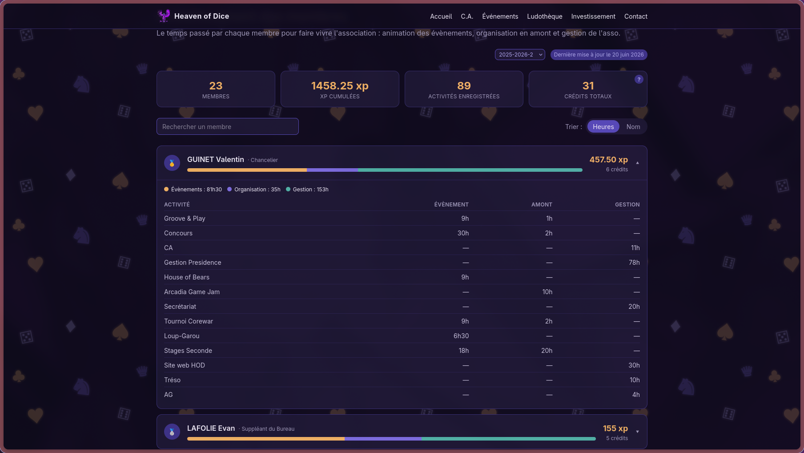

# HOD Showcase Site

Site officiel de **Heaven of Dice (HOD)**, club étudiant rattaché au BDE Epitech Lyon, développé avec _Next.js, TypeScript et Tailwind CSS_.
Ce projet sert de vitrine pour le club, ses activités et ses actualités.

## Aperçu





## Lancer le projet en local

```bash
npm install
npm run dev
```

Le site sera accessible sur : http://localhost:3000

## Contributions

Les contributions sont les bienvenues !
N’hésite pas à proposer des améliorations, corriger des rapports ou ajouter du contenu.
Plus d'informations dans [CONTRIBUTING.md](CONTRIBUTING.md)
